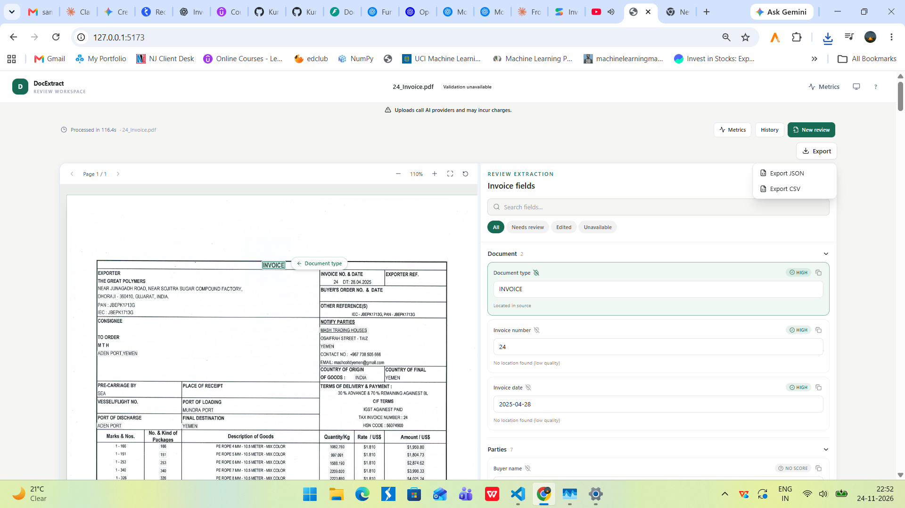
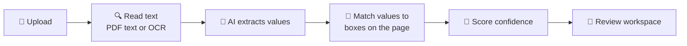
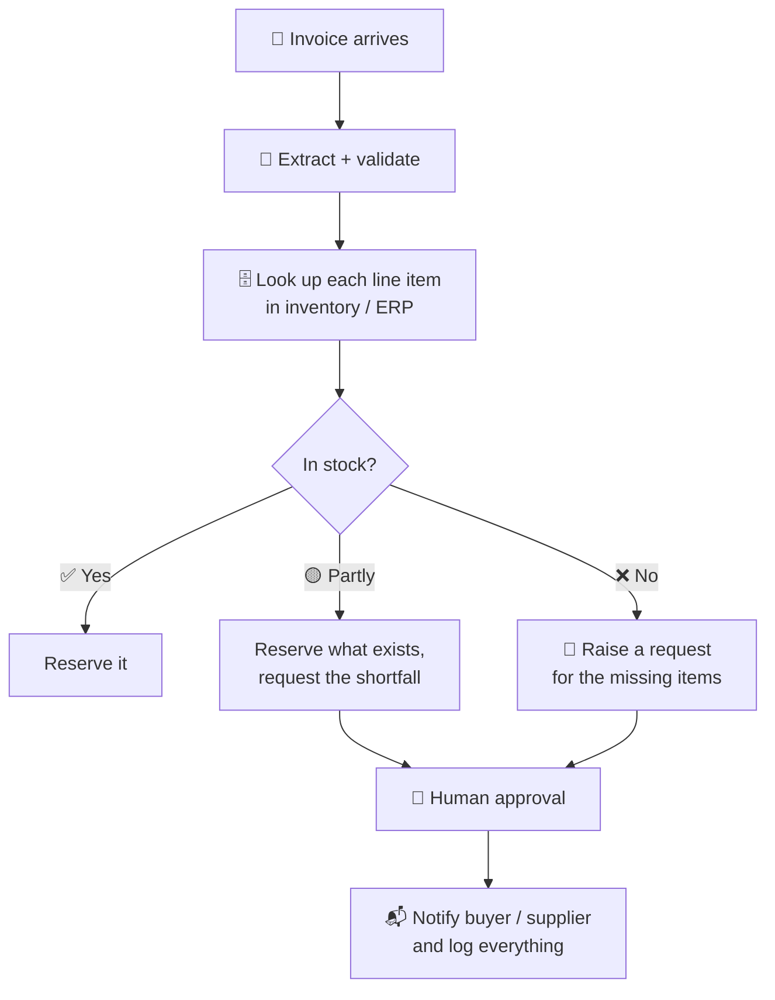
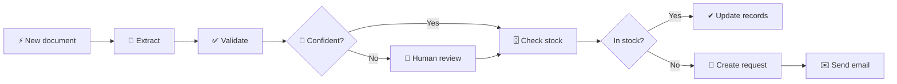

<div align="center">

# 🧾 DocExtract

### Drop in an invoice. Get clean data back. See exactly where every value came from.


[🚀 Try it](#-try-it-in-2-minutes) ·
[🎮 What you can do](#-what-you-can-do) ·
[⌨️ Cheat sheet](#️-command-cheat-sheet) ·
[🛠 Troubleshooting](#-troubleshooting) ·
[🗺 Roadmap](#-roadmap)



</div>

---

## 🚀 Try it in 2 minutes

No API key. No database. No cost. This runs the full UI on realistic sample data.

```bash
git clone https://github.com/Kumbhakarn/invoice-processing.git
cd invoice-processing/frontend
npm install
npm run dev
```

Open **http://localhost:5173**, drop any file in, and play.

> 💡 Mock mode is the default, so nothing calls an AI provider.

<details>
<summary><b>🔌 Run the real thing (backend + AI extraction)</b></summary>

<br>

> ⚠️ Real mode calls OpenAI / Gemini. **Every upload can cost money.** Test with one document at a time.

**1. Start the database** (Docker Desktop must be running)

Use the PostgreSQL container you already set up for local development, on `localhost:5432`.

**2. Start the backend** (terminal 1)

```bash
cd backend
cp .env.example .env          # Windows cmd: copy .env.example .env
# open .env and add your OpenAI / Gemini key. Never commit this file.
uv sync
uv run alembic upgrade head
uv run uvicorn docextract.main:app --reload
```

Check it: http://127.0.0.1:8000/docs

**3. Start the frontend in real mode** (terminal 2)

```bash
cd frontend
npm install
# in frontend/.env set:  VITE_USE_MOCK=false
npm run dev
```

Open **http://localhost:5173**. A yellow banner confirms you are in real mode.

</details>

---

## 🎮 What you can do

| | Feature | What happens |
|---|---|---|
| 📤 | **Upload** | Drag and drop PDFs or images. Type and size are checked before upload. Cancel any time. |
| 🤖 | **Extract** | AI reads the invoice: parties, ports, Incoterms, weights, line items, HSN codes and more. |
| 🎯 | **Locate** | Click any field and an **arrow + bounding box** points at it on the document. Scroll away and an edge pill (⬆️ / ⬇️) guides you back. |
| 🚦 | **Confidence** | Every field gets a score: 🟢 high (90%+), 🟡 medium (70–90%), 🔴 low (under 70%). |
| 🔀 | **Ambiguous values** | Same value in several places? Cycle through the candidates and pick the right one. |
| ✏️ | **Edit** | Fix values inline, with undo, redo and revert. *(Local only, not saved to the server yet.)* |
| ✅ | **Validate** | Business-rule checks flag bad dates, wrong totals, and line-item math. Click an issue to jump to the field. |
| ⏱ | **Metrics** | See time per stage, model used, fallback, and token counts. |
| 📦 | **Export** | Download the edited data as JSON or CSV. |
| 🕘 | **History** | Browse past invoices, reopen them, or delete the stored original. |

<details>
<summary><b>⌨️ Keyboard shortcuts</b></summary>

<br>

| Key | Action |
|---|---|
| `J` / `K` | Jump to the next / previous field that needs review |
| `?` | Show all shortcuts |

</details>

<details>
<summary><b>🧠 How it works (30-second version)</b></summary>

<br>



The AI only **reads values**. Locations and confidence come from regular code, so highlights never depend on an AI guessing coordinates.

</details>

---

## ⌨️ Command cheat sheet

<details open>
<summary><b>🐍 Backend</b></summary>

```bash
cd backend

uv sync                                          # install dependencies
uv run uvicorn docextract.main:app --reload      # start the API
uv run alembic upgrade head                      # apply database migrations
uv run ruff check .                              # lint
uv run mypy src                                  # type check
uv run pytest                                    # tests
```

</details>

<details open>
<summary><b>⚛️ Frontend</b></summary>

```bash
cd frontend

npm install              # install dependencies
npm run dev              # start the app (mock mode by default)
npm run build            # production build
npm run lint             # lint
npm run typecheck        # type check
npm test                 # unit tests (Vitest)
npm run test:e2e         # browser tests (Playwright, mock mode)
npm run gen:api          # regenerate API types from the backend OpenAPI schema
```

</details>

<details>
<summary><b>🌿 Git workflow</b></summary>

```bash
git switch main && git pull                 # start from the latest main
git switch -c feature/my-change             # new branch
# ...make changes...
git add <files>
git commit -m "feat: describe the change"
git push -u origin feature/my-change        # then open a Pull Request
```

</details>

<details>
<summary><b>🔗 Useful URLs while running</b></summary>

| What | URL |
|---|---|
| App | http://localhost:5173 |
| API docs (Swagger) | http://127.0.0.1:8000/docs |
| OpenAPI schema | http://127.0.0.1:8000/openapi.json |
| Health check | http://127.0.0.1:8000/api/health |
| DB readiness | http://127.0.0.1:8000/api/ready |

</details>

---

## 🛠 Troubleshooting

<details>
<summary><b>The page says "network error"</b></summary>

The backend isn't running, or you're in real mode with nothing on port 8000. Start it with `uv run uvicorn docextract.main:app --reload`, or switch back to mock mode (`VITE_USE_MOCK=true`).

</details>

<details>
<summary><b>I get a 503 error</b></summary>

No AI provider key is configured. Add `OPENAI_API_KEY` or the Gemini key to `backend/.env`. Check the exact variable names in `backend/.env.example`.

</details>

<details>
<summary><b>Highlights are in the wrong place</b></summary>

Compare with mock mode:
- **Right in mock, wrong in real** → the backend matcher found the wrong box.
- **Wrong in both** → a frontend box-to-pixel bug.

</details>

<details>
<summary><b>History page says it's disabled</b></summary>

History and document APIs are off by default. In `backend/.env` set `INVOICE_HISTORY_API_ENABLED=true` and `DOCUMENT_API_ENABLED=true`, then restart the backend. Local development only.

</details>

<details>
<summary><b>The first scanned upload is slow</b></summary>

The OCR engine loads on first use. Later uploads are faster.

</details>

<details>
<summary><b>Windows: <code>$branch is not recognized</code></b></summary>

You're in `cmd` but pasted a PowerShell script. Open a PowerShell terminal, or use `set VAR=value` and `%VAR%` in `cmd`.

</details>

<details>
<summary><b>Port already in use</b></summary>

Stop the other process, or run on another port: `uv run uvicorn docextract.main:app --reload --port 8001` (and update the Vite proxy target).

</details>

---

## 🗺 Roadmap

Where we are, and where this is going.

### ✅ Built

- [x] Extraction API with OpenAI and Gemini fallback
- [x] Field evidence: page, bounding boxes, confidence
- [x] Business validation
- [x] PostgreSQL storage and invoice history
- [x] Review workspace: viewer, locator, confidence, editing, export
- [x] Mock mode and automated tests
- [x] Local Docker Compose setup

### 🔜 Next

- [ ] 🔁 CI with GitHub Actions
- [ ] ☸️ Kubernetes (DEV / UAT / PROD)
- [ ] 📈 Prometheus and Grafana monitoring
- [ ] ⚡ Async processing and parallel batches
- [ ] 💾 Save corrections and approve results
- [ ] 🔐 Authentication

### 🔮 The big vision: from "read the invoice" to "act on it"

<details>
<summary><b>🏭 Phase 1: Connect to your database and automate requests</b></summary>

<br>

Today DocExtract stops at *"here's the data."* Next, it checks that data against your own systems and does something about it.



**Ideas on the list**
- 🔎 Match invoice lines to catalog items (fuzzy match, ask a human when unsure)
- 📊 Compare invoices with purchase orders and flag price, quantity, or tax differences
- 📨 Auto-create purchase requests or supplier emails for missing stock
- 🧯 Exception queue for anything uncertain
- 🧾 Full audit trail of every decision

**Guardrails it needs:** login and roles, human approval before anything is sent, no duplicate requests on retry, and spending limits.

</details>

<details>
<summary><b>🧩 Phase 2: Build workflows by dragging blocks (n8n-style)</b></summary>

<br>

A visual editor where anyone can wire up their own automation, with no code.



| Block type | Examples |
|---|---|
| ⚡ Triggers | Upload, email attachment, watched folder, schedule, webhook |
| 🎬 Actions | Extract, validate, database query, HTTP call, send email or chat message |
| 🔀 Logic | If / else, loop over line items, wait for approval |
| 👤 Review | Pause and send to the review workspace |
| 📈 Monitoring | Run history, step logs, retries, alerts |

**Two ways to build it:** write our own editor (for example with React Flow) for full control, or plug DocExtract into n8n as custom nodes for a faster start. We decide after Phase 1 shows which workflows people really use.

</details>

---

## 🗂 Project map

```text
invoice-processing/
├── backend/        🐍 FastAPI service (extraction, evidence, validation, history)
│   ├── src/docextract/
│   └── tests/
├── frontend/       ⚛️ React review workspace
│   ├── src/
│   └── e2e/        🎭 Playwright tests
├── docs/           📚 API contract, storage, frontend guides
├── evaluation/     🎯 Extraction accuracy evaluator
└── AGENTS.md       🤖 Rules for AI coding agents
```

<details>
<summary><b>📚 More docs</b></summary>

- [API contract](docs/api-contract.md)
- [Run locally with Docker](docs/docker-local.md)
- [Frontend architecture](docs/frontend-architecture.md)
- [Frontend user guide](docs/frontend-user-guide.md)
- [Frontend testing](docs/frontend-testing.md)
- [Frontend README](frontend/README.md)

</details>

---

## ⚠️ Good to know

- 🔓 **No authentication yet.** Local development only. Don't expose it publicly.
- 💸 **Real uploads cost money.** AI calls are billed to your keys.
- 📝 **Edits aren't saved to the server.** Export JSON or CSV to keep them.
- 📉 **Confidence scores are heuristics**, not yet calibrated on large real data.

---

<div align="center">

Licensed under [Apache 2.0](LICENSE) · Built step by step 🧱

⭐ If this helps you, star the repo.

</div>
